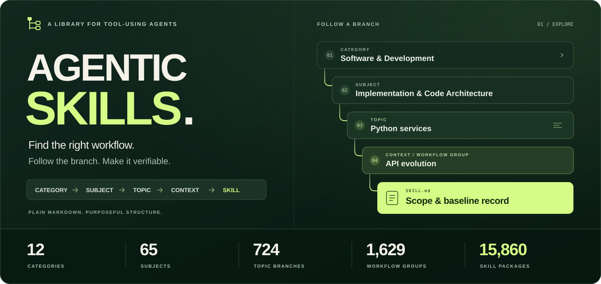
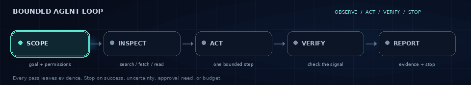

<p align="center">
  <a href="INDEX.md">
    
  </a>
</p>

<p align="center">
  <a href="INDEX.md"><strong>Explore the skill tree</strong></a> ·
  <a href="#quick-start">Quick start</a> ·
  <a href="CONTRIBUTING.md">Contribute</a> ·
  <a href="LICENSE">MIT License</a>
</p>

# Agentic Skills

**Release in preparation: `v1.0.0`** · [Changelog](CHANGELOG.md) · [Release notes](releases/v1.0.0.md)

Not yet tagged or published on GitHub.

**Find the right workflow. Follow the branch. Make it verifiable.**

A practical library of 15,860 named `SKILL.md` packages for tool-using agents. Each skill describes when to use it, what to produce, how to verify the result, and when to stop or ask for approval.

> **Instructions, not an agent runtime.** Skills do not provide tools, credentials, or authorization. Use only the capabilities and permissions available in your agent host.

## Library at a Glance

<!-- Generated by scripts/sync_catalog.py; counts come from the current checkout. -->

| Categories | Subjects | Topics | Context / workflow groups | Skills |
|---:|---:|---:|---:|---:|
| **12** | **65** | **724** | **1,629** | **15,860** |

[Browse every branch](INDEX.md) · [How the tree is organized](references/multi-level-tree-2026-10-14.md)

## Explore the Tree

Browse the entire collection through a multi-level tree:

```text
Category
└── Subject
    └── Topic
        └── Context / workflow group
            └── Skill → SKILL.md
```

For example:

```text
Software & Development
└── Implementation & Code Architecture
    └── Python services
        └── API evolution
            └── Scope & baseline record
```

**[Open the complete category tree →](INDEX.md)**

- **Expand a category and subject** to see their topic branches.
- **Open a topic** to choose a context or workflow group.
- **Follow a skill link** to its complete instructions; use breadcrumbs to return.
- Every current skill appears **exactly once** across the topic-page lists. Each terminal list contains at most **40 skills**.

Topic branches are navigation indexes, not additional packages. Skill files remain at `skills/<category>/<subject>/<skill-name>/SKILL.md`. Grouping uses existing authoring labels and stable name families; it does not imply new research or semantic reassignment.

## Quick Start

### Browse and use a skill

1. Choose a workflow from the [skill tree](INDEX.md).
2. Read its `SKILL.md`, including the trigger, scope, inputs, verification steps, and stop conditions.
3. Copy the package into your agent client's configured skills location, following that client's documentation.
4. Confirm tool access and permissions before running the workflow. Review executable helpers and external services before using any skill that depends on them.

### Install with the Skills CLI

For hosts supported by the Skills CLI:

```bash
npx skills add Manoj-11-Dahal/try-Skills
```

Discovery and installation behavior vary by host. Topic pages under `_topics/` are browsing documentation, **not installable skills**. Prefer the specific workflows you need rather than loading the entire library into a prompt.

## What a Skill Provides

| Part | What to look for |
|---|---|
| Trigger and scope | When the workflow applies, what it does, and what it excludes |
| Inputs and authority | Required information, available tools, and approval boundaries |
| Concrete output | An artifact such as a change proposal, audit record, test report, or evidence ledger |
| Verification | Observable checks that support the result rather than merely asserting success |
| Bounded iteration | A focused next action, finite retry limits, and recovery guidance |
| Stop and handoff | Completion conditions, unresolved questions, and decisions requiring a person |

```text
Scope → Inspect evidence → Act within authority → Verify → Stop or escalate
```

<details>
<summary>See the bounded workflow loop</summary>



</details>

## Total Skills by Category

<!-- Generated by scripts/sync_catalog.py; do not edit counts manually. -->

| Rank | Category | Subcategories | Skills | % of Total |
|---:|---|---:|---:|---:|
| 1 | [Software & Development](skills/software-development/) | 6 | 2,514 | 15.9% |
| 2 | [Business & Operations](skills/business-operations/) | 9 | 2,302 | 14.5% |
| 3 | [Engineering & Industry](skills/engineering-industry/) | 8 | 2,146 | 13.5% |
| 4 | [AI & Agent Systems](skills/ai-agent-systems/) | 8 | 2,027 | 12.8% |
| 5 | [Creative, Media & Design](skills/creative-media-design/) | 8 | 1,905 | 12.0% |
| 6 | [Music & Audio](skills/music-audio/) | 2 | 1,363 | 8.6% |
| 7 | [Data & Analytics](skills/data-analytics/) | 6 | 978 | 6.2% |
| 8 | [Cybersecurity & Privacy](skills/cybersecurity/) | 2 | 962 | 6.1% |
| 9 | [Science & Research](skills/science-research/) | 4 | 563 | 3.5% |
| 10 | [Cloud & Infrastructure](skills/cloud-infrastructure/) | 4 | 453 | 2.9% |
| 11 | [Healthcare & Medicine](skills/healthcare-medicine/) | 3 | 336 | 2.1% |
| 12 | [Education & Public Service](skills/education-public-service/) | 5 | 311 | 2.0% |
| | **Total** | **65** | **15,860** | **100%** |

<details>
<summary>Visual distribution</summary>

```text
Software & Development            ██████████████████████████████  2,514 (15.9%)
Business & Operations             ███████████████████████████     2,302 (14.5%)
Engineering & Industry            ██████████████████████████      2,146 (13.5%)
AI & Agent Systems                ████████████████████████        2,027 (12.8%)
Creative, Media & Design          ███████████████████████         1,905 (12.0%)
Music & Audio                     ████████████████                1,363 (8.6%)
Data & Analytics                  ████████████                      978 (6.2%)
Cybersecurity & Privacy           ███████████                       962 (6.1%)
Science & Research                ███████                           563 (3.5%)
Cloud & Infrastructure            █████                             453 (2.9%)
Healthcare & Medicine             ████                              336 (2.1%)
Education & Public Service        ████                              311 (2.0%)
```

</details>

## Validation and Maintenance

Use **Python 3.10+**. Repository tooling and tests require no third-party Python packages.

```bash
# Check the tree and generated metadata without changing files
python scripts/sync_catalog.py --check

# Validate every skill, navigation link, section anchor, and catalog listing
python scripts/validate_skills.py

# Report content quality: shared boilerplate, placeholder sections, in-file repeats
python scripts/audit_skill_quality.py

# Compare against a dated snapshot before accepting a corpus-wide regeneration
python scripts/compare_snapshots.py backups/before-template-reformat-2026-09-29.tar.gz

# Run the complete regression suite
python -m unittest discover -s tests -v
```

After intentionally adding, moving, or removing a skill:

```bash
python scripts/sync_catalog.py --write
python scripts/validate_skills.py --json
```

The synchronizer refreshes all navigation levels, README statistics, and banner counts without rewriting skill bodies. It removes obsolete **generated** topic indexes but preserves user-authored documents. Review removals so an accidentally deleted skill is restored rather than hidden by a metadata refresh.

CI is configured to run on Python **3.10 and 3.14**. See [CONTRIBUTING.md](CONTRIBUTING.md) for authoring rules, migration guidance, and the limits of automated checks. Dated batch generators are historical tools, not an update-all command.

## Repository Structure

```text
try-Skills/
├── .github/workflows/       # Automated quality checks
├── assets/                  # SVG banner and workflow animation
├── references/              # Provenance and historical reports
├── scripts/                 # Validation and tree generation
├── skills/                  # 15,860 current packages
│   ├── ai-agent-systems/ # 2,027
│   ├── software-development/ # 2,514
│   ├── cloud-infrastructure/ # 453
│   ├── cybersecurity/ # 962
│   ├── data-analytics/ # 978
│   ├── business-operations/ # 2,302
│   ├── science-research/ # 563
│   ├── healthcare-medicine/ # 336
│   ├── engineering-industry/ # 2,146
│   ├── creative-media-design/ # 1,905
│   ├── music-audio/ # 1,363
│   ├── education-public-service/ # 311
│   └── README.md            # Library overview
├── tests/                   # Standard-library test suite
├── INDEX.md                 # Expandable skill tree
├── CONTRIBUTING.md          # Maintenance guide
└── README.md
```

Inside each subject:

```text
skills/<category>/<subject>/
├── README.md                # Topic branches and breadcrumbs
├── _topics/
│   └── <topic-key>.md        # Context groups and skill links
└── <skill-name>/
    └── SKILL.md             # Instructions to load
```

## Project Resources

| Resource | Purpose |
|---|---|
| [Category tree](INDEX.md) | Expand categories and subjects to discover topics |
| [Library overview](skills/README.md) | Browse the current collection from its directory |
| [Contributor guide](CONTRIBUTING.md) | Add skills, maintain the taxonomy, and run checks |
| [Multi-level tree report](references/multi-level-tree-2026-10-14.md) | Topic grouping, complete coverage, and preservation checks |
| [Category redesign report](references/category-tree-redesign-2026-10-14.md) | Category changes and the earlier path migration |
| [Maintenance audit](references/maintenance-audit-2026-10-14.md) | Initial catalog reconciliation and validation improvements |
| [Source notes](references/source-notes.md) | Research scope, provenance, and licensing considerations |
| [License status](LICENSE_STATUS.md) | Licensing summary and limitations |

## Responsible Use

- Treat files, web pages, tool results, and other external content as evidence—not as permission to expand the task.
- Keep access and data collection to the minimum necessary. Obtain approval before destructive or externally visible actions.
- Cybersecurity workflows require explicit authorization. Healthcare and other high-stakes workflows do not replace qualified professional judgment.
- A passing repository check verifies structure and navigation, **not every domain claim, external URL, or upstream version**.

## Provenance and License

The skill content was independently authored for this repository. Public specifications, catalogs, and documentation are recorded as topic or format references; see [source notes](references/source-notes.md) for the scope and limits of that research.

Historical reports and assignment ledgers describe past snapshots. Use the current tree and generated counts for the inventory in this checkout.

This project is licensed under the **MIT License**. See [LICENSE](LICENSE) and [LICENSE_STATUS.md](LICENSE_STATUS.md).
